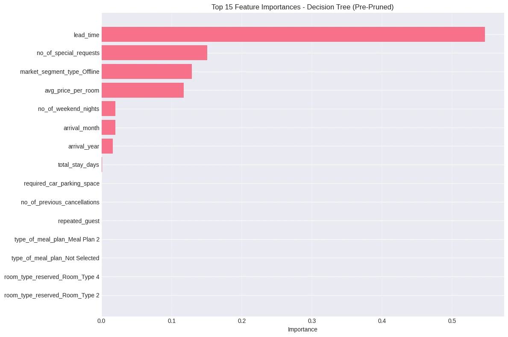

# joelraj18.github.io

Portfolio of **Joel Raj Vemuri**, Business Analyst and Data Analyst. Live at <https://joelraj18.github.io>.

Built on the [Forty](https://html5up.net/forty) template by HTML5 UP (CCA 3.0).

## Pages

| Page | Purpose |
| --- | --- |
| `index.html` | Landing page: pitch and the six project tracks |
| `about.html` | Profile, experience, skills, approach architecture and step-by-step playbooks, certifications |
| `python.html`, `sql.html`, `powerbi.html`, `tableau.html`, `excel.html` | Case studies for each analysis track. Python holds thirteen in four groups (End-to-End Projects, AI Projects, Business Analytics, Statistics & Machine Learning), SQL four, Excel two and Tableau one; Power BI still shows its coming-next block |
| `tools.html` | Tools and websites: a video-style index, then one card per project with screenshots and Approach, From the Start, Issues & Fixes, Limitations and Future Improvements tabs |
| `404.html` | Not-found page (uses root-absolute paths because GitHub Pages serves it at any URL) |

Custom styles live in `assets/css/portfolio.css` and the tabs on the About and Tools pages in `assets/js/portfolio.js`; case-study charts are in `images/projects/`, Tools page screenshots in `images/tools/`, and the files of projects that have no repository of their own (notebooks, PDF reports, datasets, a database dump) in `projects/<id>/`: link notebooks, CSV and SQL files through GitHub's viewer (`https://github.com/joelraj18/joelraj18.github.io/blob/HEAD/projects/<id>/<file>`), PDFs directly (`projects/<id>/<file>.pdf`, new tab) and Excel files with the `download` attribute; `main.css` and `main.js` are the template files (with small accessibility fixes). The menu, contact and footer blocks are identical on every page, so change them everywhere at once.

Approach tabs can be linked directly: `about.html#approach-kpi`, `#approach-sql`, `#approach-ml`, `#approach-stats`, `#approach-bi`, `#approach-excel`.

## Adding a case study

Case studies live in the "Case Studies" section of each track page: one `<article>` per project inside `<div class="case-studies">`, directly **above** the `<div class="coming-next">` block. Remove each project from the coming-next list as it is published, and delete that block once the list is empty:

```html
<div class="case-studies">

	<article class="case-study" id="inn-hotels" aria-labelledby="inn-hotels-title">
		<figure class="case-figure">
			<a href="images/projects/inn-hotels.webp">
				
				<span class="visually-hidden"> (opens the full-size chart)</span>
			</a>
			<figcaption><strong>Longer lead times cancel more</strong> One sentence on why the chart matters.</figcaption>
		</figure>
		<p class="project-kicker">Classification &middot; Hospitality</p>
		<h3 id="inn-hotels-title" class="case-title">Booking Cancellation Prediction (INN Hotels)</h3>
		<ul class="tags"><li>Python</li><li>Scikit-learn</li><li>Decision Trees</li></ul>
		<dl>
			<dt>Problem</dt>
			<dd>Which bookings are likely to cancel, and why?</dd>
			<dt>Data</dt>
			<dd>36,275 bookings, 32.8% canceled.</dd>
			<dt>Approach</dt>
			<dd>Cleaning, feature engineering, logistic regression vs. pruned decision tree.</dd>
			<dt>Result</dt>
			<dd>82.3% test accuracy against a 67.2% majority-class baseline; F1 0.69 and recall 0.59 on cancellations.</dd>
			<dt>Recommendation</dt>
			<dd>Automated reminder emails for high-risk bookings.</dd>
		</dl>
		<ul class="actions">
			<li><a href="https://github.com/joelraj18/REPO" target="_blank" rel="noopener" class="button primary">View Code<span class="visually-hidden"> (opens in a new tab)</span></a></li>
			<!-- For tools and dashboards: -->
			<li><a href="https://LIVE-LINK" target="_blank" rel="noopener" class="button">Live Version<span class="visually-hidden"> (opens in a new tab)</span></a></li>
		</ul>
	</article>

</div>
```

- **Result against a baseline.** Every result is stated against a baseline (for classification, include F1 and recall for the class that matters), using the figures exactly as the project's own result files report them. End-to-end projects add a `Deliverables` row.
- **Figure (optional).** A chart from the project, saved twice as WebP in `images/projects/`: `<id>.webp` (at most 1800 px wide) and `<id>-sm.webp` (800 px wide, for the `srcset`). The charts are drawn on white, so they sit on a white panel; tall charts are capped in height and centered. Give the real `width` and `height`, alt text that states what the chart shows, and a caption with a bold lead-in (a full stop is added after it). Selecting the chart opens it full size, which helps on phones.
- **Groups.** A page with several kinds of project, like `python.html`, splits them into groups: each gets an `<h3 class="case-group">` with an id (also listed in the `jump-links` under the section heading), a `<p class="case-group-intro">` and its own `<div class="case-studies">`, and the case-study titles in it step down to `<h4 class="case-title">`.
- **One project on several tracks.** A project can have a card on each track it really uses, written about that track's work: the end-to-end projects have their models on `python.html` and their SQL data layers on `sql.html`, where a `Full Case Study` button links back to the main card (for example `python.html#bonus-prediction`).
- When a page gets its first case study, update both its `<meta name="description">` and `<meta property="og:description">`.

## Adding a tool or website

`tools.html` uses a fuller card than the case-study template above. To add a project:

1. Copy one `<article class="case-study project-card">` inside `<div class="case-studies">` and give it a new `id`.
2. Use that id as the prefix of every tab and panel id in the card (`tab-<id>-approach` controls `<id>-approach`, and so on), so each card's tabs stay independent. A panel can be linked directly, e.g. `tools.html#datamind-issues`.
3. Add a matching entry to the `project-index` list in the Overview section. Index entries and cards take their accent color from their position, so keep both lists in the same order.
4. Screenshots: four 16:9 screens per project in `images/tools/`, each saved three ways as WebP: `<id>-1.webp` (1440×810, full size), `<id>-1-sm.webp` (640×360, the same view scaled down for the main preview's `srcset`) and `<id>-1-thumb.webp` (640×360, a zoomed crop of the screen's key content, so small thumbnails stay readable). The first screen is the card's main preview and, as its thumb, the index thumbnail; the other three sit beside it as thumbs. Keep those captions short (a one-line title and about 90 characters), because the side column is exactly as tall as the main preview. Each gets alt text describing what it shows and a caption explaining why it matters. Selecting a screenshot opens it full size (viewer in `assets/js/portfolio.js`); without JavaScript the link opens the image.
5. State every figure the way the project's own docs measured it, and put the live link first when there is one.
